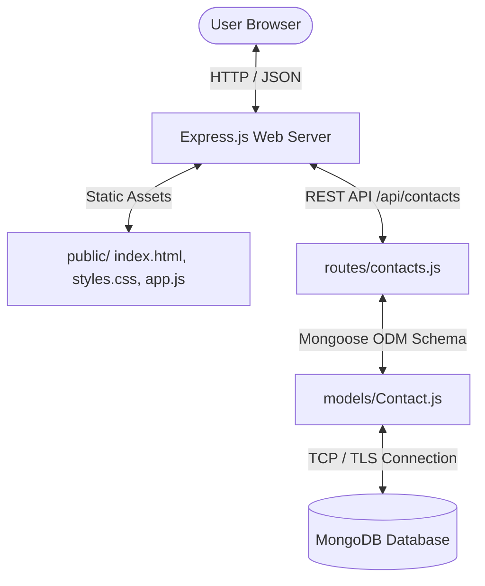

# 📇 Digital Contact Manager

> **A Full-Stack Web Application for Contact Management**  
> Developed as an Academic / Portfolio Mini-Project using Node.js, Express, MongoDB, Mongoose, HTML5, CSS3, and JavaScript.

---

## 👨‍🎓 Project & Student Information
*(Fill in your details for college project submission)*

- **Student Name:** [Your Name Here]
- **Roll / Register Number:** [Your Roll Number]
- **Department:** Computer Science and Engineering (CSE / IT)
- **Semester / Year:** Final / Pre-Final Year
- **College / University:** [Your Institution Name]
- **Project Title:** Digital Contact Manager System
- **Guide / Mentor:** [Faculty Guide Name]

---

## 📋 Project Overview & Abstract

The **Digital Contact Manager** is a modern, responsive web application designed to replace traditional paper address books with a smart, cloud-ready digital contact repository. It allows users to store, organize, search, filter, update, and export personal and professional contacts efficiently.

### Key Objectives:
- Implement full **CRUD (Create, Read, Update, Delete)** operations.
- Provide real-time **Search & Category Filtering** (College, Work, Personal, Family, Emergency).
- Display a dynamic **Dashboard Summary** showing the **total count of contacts**, favorite contacts, and category metrics.
- Support **One-Click Quick Actions**: Direct Phone Call (`tel:`), WhatsApp Direct Chat (`wa.me`), and Email (`mailto:`).
- Offer **CSV Data Export** for backup and portability.
- Ensure strict **Client-Side & Server-Side Form Validation** with MongoDB schema constraints.

---

## 🚀 Key Features

| Feature | Description |
|---|---|
| **📊 Dynamic Total Counter** | Live summary dashboard displaying total contacts, favorite contacts, and category distributions. |
| **🔍 Real-Time Instant Search** | Debounced search across Name, Phone, Email, Address, and Notes. |
| **🏷️ Category Organization** | Classify contacts into `College`, `Work`, `Personal`, `Family`, and `Emergency` with distinct color badges. |
| **⭐ Quick Favorite Toggle** | 1-click star toggle with visual highlight. |
| **💬 Direct WhatsApp & Call** | Direct links to dial numbers or open WhatsApp chats without manual copy-pasting. |
| **💾 CSV Export Utility** | Download all contacts in standard CSV format for Excel/Google Sheets. |
| **⚡ Sample Demo Seeder** | One-click button to load realistic academic/professional demo contacts for live presentation. |
| **🛡️ Safe Deletion** | Confirmation modal dialog to prevent accidental deletion. |
| **📱 Responsive UI** | Optimized for mobile phones, tablets, and desktop widescreen displays. |

---

## 🛠️ Technology Stack

- **Frontend:** HTML5, Modern CSS3 (CSS Variables, Flexbox, CSS Grid), Vanilla JavaScript (ES6+ Fetch API, DOM manipulation).
- **Backend:** Node.js, Express.js (RESTful API architecture).
- **Database:** MongoDB (Local or MongoDB Atlas Cloud) with Mongoose ODM.
- **Environment Management:** `dotenv` for configuration security.
- **Cross-Origin Handling:** `cors` middleware.

---

## 🏗️ System Architecture



---

## 📁 Project Structure

```text
digital-contact-manager/
├── models/
│   └── Contact.js          # Mongoose schema and database validation
├── routes/
│   └── contacts.js         # Express REST API route handlers
├── public/
│   ├── index.html          # Frontend user interface
│   ├── styles.css          # Responsive styling and CSS animations
│   └── app.js              # Frontend logic, state management, and API calls
├── .env                    # Local environment variables (PORT, DB URI)
├── .env.example            # Environment configuration template
├── .gitignore              # Files excluded from Git version control
├── package.json            # Project dependencies and npm scripts
├── README.md               # Complete documentation and viva guide
└── server.js               # Main Express application entry point
```

---

## ⚙️ Setup and Installation Guide

### Prerequisites
- [Node.js](https://nodejs.org/) installed (v18 or higher recommended).
- Either:
  1. **MongoDB Community Server** installed and running locally, OR
  2. A free **MongoDB Atlas** cloud account.

### Step 1: Open the Project
Open the project directory in VS Code or your terminal:
```bash
cd "d:\mangement contact"
```

### Step 2: Install Node Dependencies
Run the following command in the terminal to install required packages:
```bash
npm install
```

### Step 3: Configure Environment Variables
A `.env` file is already provided. By default, it connects to local MongoDB:
```env
PORT=3000
MONGODB_URI=mongodb://127.0.0.1:27017/digital_contact_manager
```

> **Using MongoDB Atlas (Cloud Database)?**  
> If you don't have local MongoDB installed, simply replace the `MONGODB_URI` line in `.env` with your free Atlas connection string:
> ```env
> MONGODB_URI=mongodb+srv://<your_username>:<your_password>@cluster0.mongodb.net/digital_contact_manager?retryWrites=true&w=majority
> ```

### Step 4: Run the Application

- **Development Mode (Auto-restart on code edit):**
  ```bash
  npm run dev
  ```
- **Standard Start:**
  ```bash
  npm start
  ```

### Step 5: Open in Your Browser
Visit: **[http://localhost:3000](http://localhost:3000)**

---

## 📡 REST API Documentation

| Method | Endpoint | Description | Query Parameters |
|---|---|---|---|
| **GET** | `/api/health` | Check server and database status | None |
| **GET** | `/api/contacts` | List contacts with filtering & sorting | `search`, `category`, `favorite`, `sortBy` |
| **GET** | `/api/contacts/stats` | Retrieve total contact summary statistics | None |
| **GET** | `/api/contacts/:id` | Fetch single contact by MongoDB `_id` | None |
| **POST** | `/api/contacts` | Create a new contact | None (JSON Body) |
| **PUT** | `/api/contacts/:id` | Update an existing contact | None (JSON Body) |
| **PATCH** | `/api/contacts/:id/favorite` | Toggle favorite star status | None |
| **DELETE** | `/api/contacts/:id` | Delete a contact by ID | None |
| **POST** | `/api/contacts/seed` | Seed realistic demo contacts | `?force=true` |

### Sample JSON Request Body (POST / PUT):
```json
{
  "name": "Ananya Sharma",
  "phone": "+91 98765 43210",
  "email": "ananya.sharma@example.com",
  "category": "College",
  "address": "Campus Hostel Block B, Vijayawada",
  "notes": "Class Representative & Project Member",
  "isFavorite": true
}
```

---

## 🎓 Viva Voce / Project Presentation Q&A

**Q1: What is the purpose of Mongoose in this project?**  
*Answer:* Mongoose is an Object Data Modeling (ODM) library for MongoDB and Node.js. It enforces a strict schema structure, data types, required constraints, regex validation, and default values over schemaless MongoDB collections.

**Q2: What is the difference between PUT and PATCH?**  
*Answer:* `PUT` updates the entire resource with all provided fields, while `PATCH` updates specific partial fields (for example, in our project, `/api/contacts/:id/favorite` uses `PATCH` to toggle only the `isFavorite` boolean).

**Q3: How does the application search contacts?**  
*Answer:* The backend uses MongoDB regex pattern matching (`$or` with `$regex`) across the `name`, `phone`, `email`, `address`, and `notes` fields, allowing case-insensitive real-time filtering.

**Q4: How does the frontend communicate with the backend?**  
*Answer:* The frontend uses the asynchronous JavaScript `fetch()` API with `async/await` to send HTTP requests (`GET`, `POST`, `PUT`, `DELETE`, `PATCH`) with JSON payloads and dynamically updates the DOM without reloading the page (Single Page Application behavior).

**Q5: Why is `.env` added to `.gitignore`?**  
*Answer:* To protect sensitive credentials such as database passwords and connection URIs from being exposed in public version control repositories like GitHub.

---

## 📜 License
This project is open-source and intended for academic and learning purposes.
